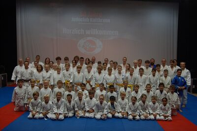
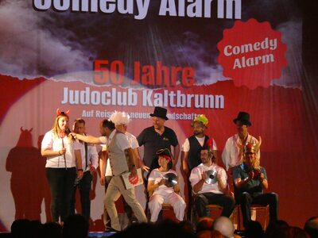
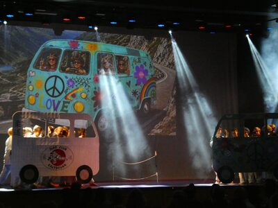
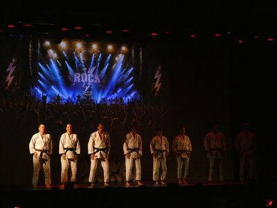

Judo, Inlinehockey, Volleyball, Musik und jede Menge Humor: Am Samstag, 19. September 2026, feierte der Judo Club Kaltbrunn sein 50-jähriges Bestehen mit einer besonderen Jubiläumsshow. Unter dem Motto «Auf Reisen zu neuen Freundschaften» erlebten rund 300 Gäste im Kupfentreff einen abwechslungsreichen Abend voller Sport, Unterhaltung und Gemeinschaft.

Bereits um 17 Uhr begann das Jubiläum mit einem Sponsoren-Apéro, der vom Musikverein Eintracht Kaltbrunn musikalisch begleitet wurde. Um 19 Uhr fiel der Startschuss zur grossen Jubiläumsshow. Das Comedy-Duo Comedy Alarm führte mit viel Humor durch den Abend. Zum Auftakt blickten OK-Präsident Pascal Kläger und Vereinspräsidentin Denise Kuster gemeinsam auf 50 Jahre Vereinsgeschichte sowie die Vorbereitungen zum Jubiläum zurück.

Anschliessend begann die eigentliche «Reise zu neuen Freundschaften». Rund 50 Judokas – von den jüngsten Piccolos bis zu den Erwachsenen – nahmen das Publikum mit auf eine Reise durch die regionale Vereinswelt. An jeder Station entdeckten sie Gemeinsamkeiten zwischen dem Judo und einem anderen Verein. Eigens produzierte Videos zeigten jeweils den Besuch beim entsprechenden Verein und leiteten die Auftritte ein.

Die Unterstufe eröffnete mit ihrer Show die gemeinsame Reise. Danach führte der erste Halt die Oberstufe zum Inlinehockeyclub Linth. Unter dem Motto Schnelligkeit zeigten die Judokas mit schnellen Bewegungen, präzisen Reaktionen und dynamischen Judotechniken, was die beiden Sportarten verbindet.

Anschliessend gehörte die Bühne den jüngsten Judokas. Beim Besuch von JUMO Kaltbrunn stand der Zusammenhalt im Mittelpunkt. Mit viel Freude und Begeisterung zeigten die Piccolos, wie wichtig Vertrauen, Teamgeist und gegenseitige Unterstützung sind.

Nach der Pause sorgte Comedy Alarm für zahlreiche Lacher, bevor die Reise weiterging. Die Mittelstufe besuchte den Volleyballclub Linth und widmete sich dem Thema Dynamik. Mit Sprüngen, schnellen Bewegungen und einer Kombination aus Volleyball und Judo entstand ein abwechslungsreicher Auftritt.

Den letzten Halt gestalteten die erwachsenen Judokas gemeinsam mit dem Musikverein Eintracht Kaltbrunn. Unter dem Motto Rhythmus verschmolzen Musik, Bewegung und Judotechniken zu einem stimmungsvollen Finale.

Zum grossen Abschluss kamen nochmals alle mitwirkenden Judokas auf die Bühne. Von den kleinsten Piccolos bis zu den Erwachsenen standen sämtliche Generationen des Vereins gemeinsam im Rampenlicht und setzten damit einen besonderen Schlusspunkt unter die Jubiläumsshow.

## Ein Jubiläum, das verbindet

Nach der Show war der Abend noch lange nicht vorbei. Die Schnüffler Guggä Kaltbrunn sorgte für zusätzliche Stimmung, bevor bei Musik und Barbetrieb gemeinsam weitergefeiert wurde.

Ein besonderer Dank gilt allen Judokas und Trainern, den mitwirkenden Vereinen, den Sponsoren, den zahlreichen Helferinnen und Helfern sowie dem Organisationskomitee, das die Jubiläumsfeier während vieler Monate mit grossem Engagement vorbereitet hatte.

Das Jubiläum zeigte, wofür der Judo Club Kaltbrunn seit 50 Jahren steht: Sport, Zusammenhalt und Freundschaft. Das Motto «Auf Reisen zu neuen Freundschaften» wurde an diesem Abend nicht nur auf der Bühne präsentiert, sondern gemeinsam gelebt.

Nach 50 Jahren ist die Reise des Judo Club Kaltbrunn noch lange nicht zu Ende.

